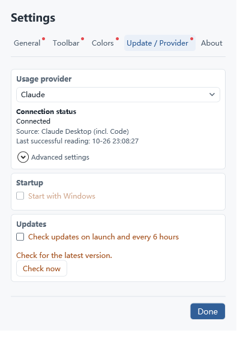

# Quick guide

[中文](guide.zh-CN.md) · **English** · [Home](README.en.md)

1. Download `UsageQuery.exe` from [Releases](https://github.com/ruya-suihe/ai-quota-widget/releases/latest) and run it on Windows.
2. Sign in to the relevant client, then choose Codex, Claude or Cursor in Settings → Update / Provider. Auto prefers CLI and uses Desktop only when the CLI sign-in file is absent.
3. Drag to move and scroll to scale. Outside Minimal mode, hover to expand and move away to collapse.
4. The toolbar contains Settings, Lock, Refresh and Close; placement and order are configurable. Fresh settings use width 200, Normal mode and Ink landscape; saved mode choices are preserved.

## Display and colors

- **Minimal:** quota bars and reference markers only; disable it for values and countdowns.
- **Text threshold:** applies only when collapsed, 80% by default.
- **Backdrop:** Original artwork, 16:9 or Free, with full proportional artwork and blended padding. Free allows manual bar heights. Old 4:3 settings migrate to 16:9.
- **Palettes:** click to apply; custom cards can be saved/deleted and duplicates report the existing name. Standard and animated cards have separate tabs.
- **Waves:** optional, including motion near text and 0–5 px travel.

## Refresh and troubleshooting

Codex normally queries every 30 seconds and supplements from local records every 15 seconds. Claude normally queries every 15 seconds, slowing down to at most five minutes after rate limits; Cursor queries every 15 seconds. Failures back off; server rate-limit waits are respected. Polling frequency does not guarantee fresh platform accounting.

For missing data, check provider/source and client sign-in. For missing text, check Minimal mode and the threshold. Cursor uses its actual billing cycle or unified weekly pool; missing windows never become invented percentages.

Windows startup and automatic update checks are optional. Updates open the release page for manual downloads. About provides the project QR code and author links.

Claude/Cursor are experimental. Claude Desktop Code was verified with a real Windows account. Screenshots use sample data.

Connection status, actual source and last successful reading are visible directly, with retry on failure. Sign-in selection, folders, usage files and collectors are under Advanced settings. Claude Desktop Code needs no CLI or plugin installation and its files remain unchanged.

Expanded labels are shortened to 5h / Week (五 / 周 in Chinese). Claude advanced settings offer local Code usage-rate estimates, alerts and sound, all disabled by default. ≈ is a local estimate; server quota remains authoritative.
