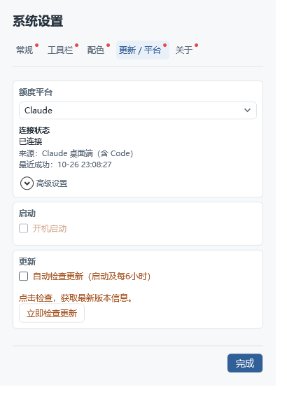

# 快速使用

**中文** · [English](guide.en.md) · [首页](README.md)

1. 从 [Releases](https://github.com/ruya-suihe/ai-quota-widget/releases/latest) 下载 `UsageQuery.exe`，在 Windows 上双击运行。
2. 先在对应客户端登录，再进入“设置 → 更新／平台”选择 Codex、Claude 或 Cursor。自动来源优先 CLI，仅当 CLI 登录文件不存在时选择桌面端。
3. 拖动窗口移动，滚轮缩放；非极简模式下，移入展开、移开收起。
4. 工具栏依次为设置、锁定、刷新、关闭，可调整位置与顺序。默认宽度 200、极简模式、山水主题。

## 显示与配色

- **极简**：只保留额度条与参考三角；关闭后可查看数值和倒计时。
- **文字隐藏阈值**：只在收起时生效，默认 80%。
- **背景比例**：原图、16:9、自由；原画等比显示并融合补边。自由模式可手动调条高。旧 4:3 设置自动转为 16:9。
- **色卡**：点击应用；自定义卡可保存、删除，重复配置会提示已有名称。普通色卡与动态主题分栏显示。
- **波浪**：可开启、允许文字处波动，幅度 0–5 px。

## 刷新与常见问题

Codex 正常每 30 秒查询，15 秒补读本地记录；Claude／Cursor 正常每 15 秒查询。失败时退避重试，限流时等待服务端指定时间；请求频率不保证平台统计同步更新。

没有数据时核对平台、来源及客户端登录；文字不见时检查极简模式与隐藏阈值。Cursor 显示实际账期或统一周额度，缺少额度窗口时不会编造百分比。

开机启动、自动更新检查均为可选。更新仅打开发布页供手动下载；“关于”提供项目二维码和作者链接。

Claude／Cursor 为试验接入；Claude Desktop Code 已通过 Windows 本机账户查询验证。截图为示例数据。

连接状态、来源及最近成功时间直接显示；失败时可重试。登录来源、配置目录、用量文件和采集工具收在'高级设置'。Claude Desktop Code 无需安装 CLI 或插件，不改写 Claude 文件。
